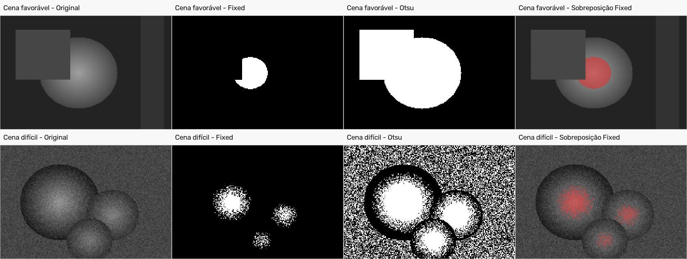

# Mini relatório — M2.1

## Alvo e imagens

O alvo deste estudo são as regiões circulares mais claras das imagens sintéticas. A imagem favorável tem uma forma circular em degradê, parcialmente coberta por um quadrado, e uma faixa retangular no fundo. A imagem difícil tem três regiões circulares próximas e ruído no fundo. Assim, a segunda cena permite observar o que acontece quando as regiões se aproximam e o fundo não é uniforme.

As duas imagens originais estão preservadas em `images/input/` em PNG. Não apliquei filtro de suavização antes da comparação; converti as imagens de três canais para escala de cinza, conforme necessário para os limiares.

## Métodos e parâmetros

Comparei o mesmo par de métodos nas duas imagens:

| Imagem | Configuração fixa | Segunda configuração |
| --- | --- | --- |
| Favorável | `fixed`, `--threshold 120` | `otsu` |
| Difícil | `fixed`, `--threshold 110` | `otsu` |

No método fixo, a regra do programa é intensidade maior ou igual ao limiar como objeto (`255`), e abaixo como fundo (`0`). Otsu calcula o limiar automaticamente. Não usei inversão porque, neste teste, o alvo escolhido são as partes mais claras das formas. A máscara final foi salva em PNG.

Os comandos completos para repetir a comparação estão no `README.md`. Por exemplo:

```bash
python -m pdi_lab --input images/input/cena_favoravel.png --output images/output/cena_favoravel_fixed.png --operation segment --method fixed --threshold 120
python -m pdi_lab --input images/input/cena_favoravel.png --output images/output/cena_favoravel_otsu.png --operation segment --method otsu
```

## Proporção de primeiro plano

| Imagem | Método | Pixels brancos | Proporção |
| --- | --- | ---: | ---: |
| Favorável | Fixo, limiar 120 | 1.293 | 0,0367 |
| Favorável | Otsu | 10.932 | 0,3106 |
| Difícil | Fixo, limiar 110 | 1.951 | 0,0417 |
| Difícil | Otsu | 21.566 | 0,4608 |

A proporção é a quantidade de pixels brancos dividida pela quantidade total de pixels. Ela descreve a área marcada pela máscara, mas, sem uma máscara de referência, não mede acurácia.

## Comparação visual

Na figura, a máscara fixed deixa em vermelho as regiões que selecionou na sobreposição com a imagem original. O método fixo seleciona áreas menores; nas duas cenas, isso também deixa partes das regiões circulares sem marcação. Otsu seleciona uma área muito maior, incluindo porções extensas do fundo na cena difícil.



## Discussão e escolha para o M2.2

O limiar fixo foi mais controlado neste conjunto: marcou cerca de 3,7% e 4,2% das imagens, enquanto Otsu marcou 31,1% e 46,1%. Visualmente, o fixed perde partes mais escuras das formas, então não representa seus contornos completos; já Otsu inclui muito fundo, principalmente na cena com ruído. Para iniciar o M2.2, escolhi as máscaras do fixed por produzirem menos regiões brancas do fundo. Essa escolha é apenas a configuração mais útil para continuar a análise neste conjunto, não uma afirmação de que a máscara seja perfeita.

O limiar foi o parâmetro mais sensível do método fixo: mudar esse valor altera diretamente quantos pixels entram na máscara. No M2.2, falsos positivos do fundo podem virar componentes extras, enquanto partes ausentes ou contornos interrompidos podem fragmentar uma mesma região ou apagar detalhes. Quando duas regiões se tocam, também podem ser contadas como um único componente.
