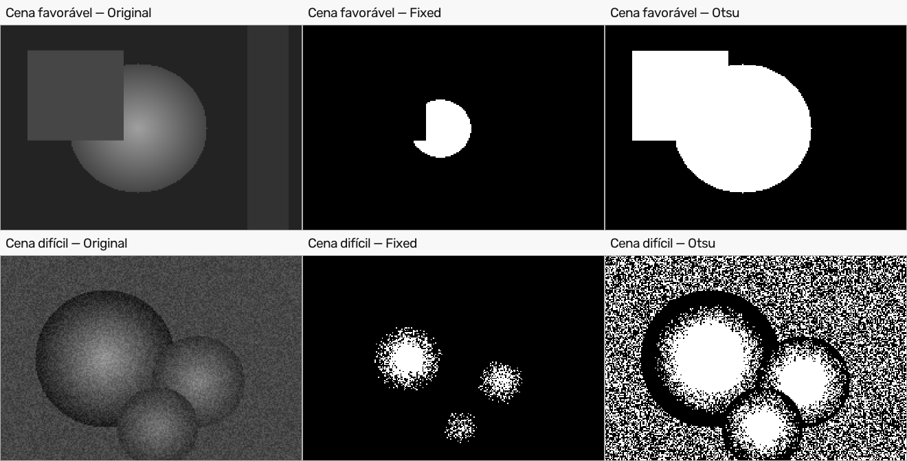
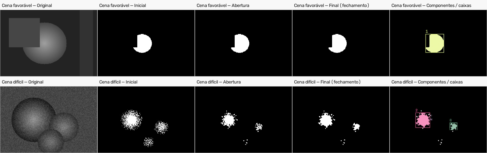

# Mini relatório — M2.1 e M2.2

## M2.1 — Segmentação e máscaras

### Alvo e imagens

O alvo deste estudo são as regiões circulares mais claras das imagens sintéticas. A imagem favorável tem uma forma circular em degradê, parcialmente coberta por um quadrado, e uma faixa retangular no fundo. A imagem difícil tem três regiões circulares próximas e ruído no fundo. Assim, a segunda cena permite observar o que acontece quando as regiões se aproximam e o fundo não é uniforme.

As imagens originais estão preservadas em `images/input/` em PNG. Não apliquei filtro de suavização antes da comparação; converti as imagens de três canais para escala de cinza.

### Métodos e parâmetros

| Imagem | Configuração fixa | Segunda configuração |
| --- | --- | --- |
| Favorável | `fixed`, `--threshold 120` | `otsu` |
| Difícil | `fixed`, `--threshold 110` | `otsu` |

No método fixo, a regra é intensidade maior ou igual ao limiar como objeto (`255`), e abaixo como fundo (`0`). Otsu calcula o limiar automaticamente. Não usei inversão porque o alvo escolhido são as partes mais claras das formas. As máscaras foram salvas em PNG. Os comandos de reprodução estão no `README.md`.

### Proporção de primeiro plano

| Imagem | Método | Pixels brancos | Proporção |
| --- | --- | ---: | ---: |
| Favorável | Fixo, limiar 120 | 1.293 | 0,0367 |
| Favorável | Otsu | 10.932 | 0,3106 |
| Difícil | Fixo, limiar 110 | 1.951 | 0,0417 |
| Difícil | Otsu | 21.566 | 0,4608 |

A proporção é a quantidade de pixels brancos dividida pela quantidade total de pixels. Ela descreve a área marcada pela máscara, mas, sem uma máscara de referência, não mede acurácia.

O limiar fixo seleciona regiões menores, mas deixa partes mais escuras das formas sem marcação. Otsu marca uma área muito maior, incluindo bastante fundo na cena difícil. Para seguir ao M2.2, escolhi as máscaras do método fixo por produzirem menos regiões brancas do fundo. Essa escolha é prática para continuar a análise neste conjunto, não significa que os contornos estejam completos. O limiar foi o parâmetro mais sensível: alterá-lo muda diretamente a quantidade de pixels selecionados. Falsos positivos, fragmentos e regiões que se encostam podem distorcer a contagem de componentes.

## M2.2 — Componentes conexos e sequência morfológica

### Máscaras e parâmetros

Reproduzi as máscaras pela operação `segment`: `cena_favoravel.png` com limiar fixo 120 e `cena_dificil.png` com limiar fixo 110. O objeto selecionado está em branco (255) e o fundo em preto (0). Analisei a conectividade 4 e 8 na mesma máscara; a contagem principal e os CSVs usam conectividade 8. A sequência foi abertura seguida de fechamento, com elemento estruturante elíptico 3 × 3 e uma iteração em cada operação.

Usei `--min-area 10`: um componente é marcado como mantido quando sua área é de pelo menos 10 pixels. O filtro não remove linhas do CSV; a coluna `kept` indica o resultado, e os resumos guardam as contagens brutas e filtradas.

### Estágios morfológicos

A figura mostra as duas imagens, as máscaras antes e depois de cada operação e a visualização final dos componentes mantidos com suas caixas delimitadoras.

A abertura foi escolhida para remover pontos isolados e ruído branco. O fechamento veio depois para recuperar pequenos furos e interrupções que sobrassem. São objetivos diferentes, embora a abertura também possa apagar partes finas das formas e o fechamento possa aproximar ou fundir regiões próximas.

### Contagem e área antes/depois

| Cena | Componentes brutos inicial → final (8 conexões) | Mantidos inicial → final (área ≥ 10) | Pixels brancos inicial → final |
| --- | ---: | ---: | ---: |
| Favorável | 1 → 1 | 1 → 1 | 1.293 → 1.293 |
| Difícil | 121 → 14 | 5 → 3 | 1.951 → 1.186 |

Na cena favorável, as conectividades 4 e 8 encontraram um componente antes e depois da morfologia. A abertura removeu um pixel e o fechamento o recuperou; a área final ficou igual à inicial. Nesse caso simples, a sequência quase não alterou a máscara.

Na cena difícil, a contagem inicial foi 299 com conectividade 4 e 121 com conectividade 8. Depois da sequência, foram 16 e 14, respectivamente. A abertura reduziu a contagem por remover componentes pequenos, mas a área branca caiu de 1.951 para 1.061 pixels no estágio aberto. Após o fechamento, a área final ficou em 1.186 pixels. Essa limpeza ajuda a reduzir ruído, mas também pode perder detalhes das regiões circulares — um efeito indesejado a considerar.

### Diferença entre conectividades e limitações

A conectividade 4 considera vizinhos horizontais e verticais. A conectividade 8 também considera vizinhos diagonais; por isso, pixels diagonais podem ser um componente só em 8 e dois em 4. A cena difícil tem muitos pequenos fragmentos, então a diferença inicial foi grande. Após a morfologia, ainda houve diferença (16 contra 14), mas menor.

A contagem final da cena difícil cai de 121 para 14 componentes brutos e, com o filtro de área, ficam 3. Isso não quer dizer que existam exatamente três objetos reais: ruído pode criar componentes, partes apagadas podem quebrar um objeto e regiões encostadas podem ser unidas. A sequência ajuda a limpar o ruído nessa cena, mas pode remover detalhes finos e não resolve por si só a separação de objetos que se tocam.

Os CSVs iniciais e finais não incluem o fundo. Conferi que a soma das áreas de cada CSV bruto corresponde aos pixels brancos da máscara da respectiva etapa. Os parâmetros, contagens por conectividade e áreas também ficam nos arquivos `results/*_summary.json`. Não usei máscara de referência nem uma contagem manual como verdade-terreno.
